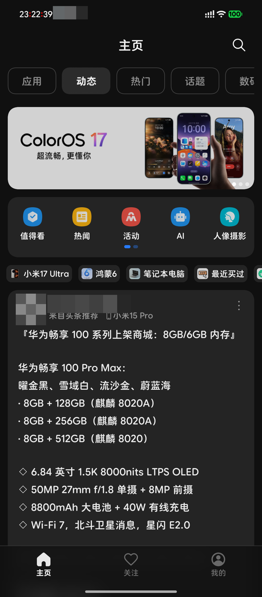
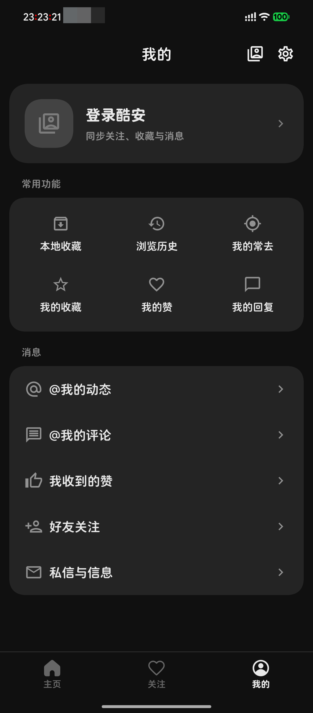
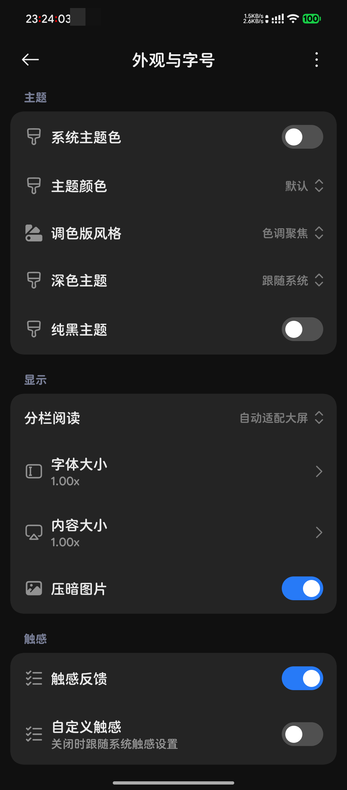

<div align="center">


# c001apk

**原生 Android · miuix 界面 · 非官方酷安客户端**

[](LICENSE)
[](docs/MIUIX_MIGRATION.md)
[](https://github.com/compose-miuix-ui/miuix)


[界面预览](#界面预览) · [功能](#功能) · [下载安装](#下载安装) · [自行构建](#自行构建) · [项目文档](#项目文档) · [致谢与许可](#致谢与许可)

</div>

## 关于

基于 [frisk1127/c001apk-compose](https://github.com/frisk1127/c001apk-compose) 继续开发，使用 Kotlin、Jetpack Compose 和原生 [miuix](https://github.com/compose-miuix-ui/miuix) 组件，围绕动态浏览、图文阅读和日常互动重新整理界面。

功能参考 [TG-Twilight/c001apk](https://github.com/TG-Twilight/c001apk) 的 Android 增量，采用「主页 / 关注 / 我的」导航，补齐多账号、本地关注、Markdown、正文导出和应用更新等能力。视觉与交互规范参考 [Mishka UI 规范](https://github.com/YuKongA/Mishka/blob/main/docs/ui-guidelines.md)，在 Android 上使用原生 Compose 实现。

## 界面预览

通过 ADB 截取的 Android 真机画面，使用设备当前的深色主题与字体。可见头像、昵称及通知图标已在本地像素化处理，其余画面保持原样；「我的」展示游客状态。

<table align="center">
  <tr>
    <th>主页</th>
    <th>我的</th>
    <th>外观与字号</th>
  </tr>
  <tr>
    <td></td>
    <td></td>
    <td></td>
  </tr>
</table>

## 功能

<table align="center">
  <thead>
    <tr>
      <th align="center">浏览与互动</th>
      <th align="center">整理与关注</th>
      <th align="center">界面与阅读</th>
    </tr>
  </thead>
  <tbody>
    <tr>
      <td>动态、文章、评论与用户主页</td>
      <td>多账号管理与游客模式</td>
      <td>原生 miuix 组件、圆角与按压反馈</td>
    </tr>
    <tr>
      <td>搜索动态、应用、用户和话题</td>
      <td>本地关注、悄悄关注与关注分类</td>
      <td>明暗主题、系统主题色与自定义配色</td>
    </tr>
    <tr>
      <td>应用、话题、产品详情与话题排序</td>
      <td>本地收藏、浏览历史与内容屏蔽</td>
      <td>字体、内容大小与图片显示设置</td>
    </tr>
    <tr>
      <td>发帖、回复、点赞与自己的动态管理</td>
      <td>账号收藏与收藏夹选择</td>
      <td>Markdown 阅读、代码、表格与原文切换</td>
    </tr>
    <tr>
      <td>文字、图片、动态私信与酷安小秘书</td>
      <td>分享链接与外部链接打开</td>
      <td>Markdown / 离线 HTML 正文导出</td>
    </tr>
    <tr>
      <td>图片预览、原图查看、保存与失败重试</td>
      <td>独立应用更新检查</td>
      <td>宽屏多列、侧边导航与分栏阅读</td>
    </tr>
  </tbody>
</table>

- **围绕阅读整理页面**：动态详情将作者与正文放入连续阅读卡片，评论独立分区；用户主页集中展示封面、头像、资料、统计与关注操作。
- **本地关注独立保存**：游客也可以关注感兴趣的用户，按分类浏览动态；本地名单不会同步成酷安账号关注。
- **数盟 ID 自动管理**：默认使用 native SDK 获取并缓存，已有标识继续复用，也支持手动填写与官方设备标识导入。
- **分享默认使用 Coolapk1s**：生成 `www.coolapk1s.com` 链接，同时识别酷安官方域名及带、未带 `www` 的 Coolapk1s 链接。

功能实现与验证范围分别记录在 [移植跟踪](docs/TWILIGHT_PORT.md) 和 [验证记录](docs/VERIFICATION.md)。登录、验证码及部分账号操作仍受服务端限制；宽屏布局和部分互动流程尚需进一步真机验证。

## 下载安装

当前源码支持 **Android 7 / API 24 及以上的 ARM64 设备**。模糊效果需要 Android 13 及以上；旧系统的顶部栏、标签栏和底部栏使用主题纯色。

正式 APK 请前往 [GitHub Releases](https://github.com/KiritoXDone/c001apk/releases/latest) 下载，每个版本同时提供签名校验报告与 SHA256SUMS。也可按下方步骤自行构建；配置签名并手动运行 [Android 工作流](.github/workflows/android.yml) 后，可从 Actions 的 Artifacts 获取构建产物。

应用显示名称为 **c001apk**，独立包名为 `com.example.c001apk.compose`，可与其他包名的版本共存。账号与本地数据不会从原版或 Flutter 版自动迁移；同包名、同签名的后续版本可覆盖安装并保留数据。

| 构建类型 | R8 代码压缩、优化与混淆 | 未使用资源裁剪 | 用途 |
| --- | --- | --- | --- |
| Debug | 关闭 | 关闭 | 开发、调试 |
| Release | 默认开启 | 默认开启 | 日常使用与分发 |
| Release，传入 `-PdisableR8=true` | 关闭 | 关闭 | 排查优化相关问题 |

本地未配置发布密钥时，Release 也会使用本机调试密钥签名；**签名类型与是否启用 R8 是两个独立配置**。公开分发时应使用并妥善保管固定的发布密钥，以保证后续覆盖更新。

## 自行构建

### 环境

- JDK 21（miuix-nav 的内联 API 使用 JVM 21 字节码）。
- Android SDK：`platforms;android-34`、`platforms;android-35`、`platforms;android-37.0` 和 `build-tools;36.0.0`。
- 使用仓库自带的 Gradle Wrapper；Gradle、AGP、Kotlin 等版本已固定在工程配置中。
- 克隆仓库时保留 Git 历史。`versionCode` 使用提交计数生成，直接下载不含 `.git` 的源码 ZIP 无法按当前配置构建。

配置 `JAVA_HOME`，通过 `ANDROID_HOME` 或 `local.properties` 中的 `sdk.dir` 指定 Android SDK。在仓库根目录执行：

```sh
# Release：默认启用 R8 和资源压缩
bash ./gradlew :app:assembleRelease

# Debug
bash ./gradlew :app:assembleDebug
```

Windows 可将 `bash ./gradlew` 替换为 `gradlew.bat`。

构建产物：

- Release：`app/build/outputs/apk/release/c001apk_<版本名>(<版本号>).apk`
- Debug：`app/build/outputs/apk/debug/app-debug.apk`

版本名可通过 `-PappVersion=x.y.z` 指定。发布签名支持以下环境变量，也支持 `local.properties` 中去掉 `C001APK_` 前缀的同名配置：

```text
C001APK_KEYSTORE_PATH
C001APK_KEYSTORE_PASSWORD
C001APK_KEY_ALIAS
C001APK_KEY_PASSWORD
```

配置完成后，可用 `-PrequireReleaseSigning=true` 要求构建必须使用已配置的发布密钥。GitHub Actions 的 Release 构建还要求 `KEYSTORE_BASE64`、`KEYSTORE_PASSWORD`、`KEY_ALIAS`、`KEY_PASSWORD` 和 `SIGNING_CERT_SHA256` Secrets；工作流会校验 APK 身份和签名，再上传产物。推送 `vMAJOR.MINOR.PATCH` 标签会调用同一构建流程，并在校验通过后自动发布 APK、校验报告和 SHA256SUMS 到 GitHub Release。

### 检查与验证

```sh
# 单元测试、Lint 与安装包校验工具测试
bash ./gradlew :app:testDebugUnitTest :media-support:testDebugUnitTest :app:lintDebug
python3 -m unittest discover -s tools -p 'test_*.py'

# 校验 APK；替换为实际路径与预期签名证书摘要
python3 tools/verify_apk.py /path/to/app.apk \
  --sdk "$ANDROID_HOME" \
  --certificate-sha256 '预期证书的SHA256摘要'
```

校验工具检查包名、最低 Android 版本、ARM64、运行必需资源、原生库压缩、签名证书、v2/v3 签名与 ZIP 对齐。设备测试和显式启用网络测试的方式见 [改造与构建说明](docs/MIUIX_MIGRATION.md)。历史验证结果见 [验证记录](docs/VERIFICATION.md)，不代表每次提交都已执行全部检查。

### 发布版本

先更新 `CHANGELOG.md`，提交代码后创建并推送版本标签：

```sh
git tag v1.4.5
git push origin v1.4.5
```

[发布工作流](.github/workflows/release.yml) 从标签读取版本号，依次执行单元测试、Lint、Release 构建和签名校验。全部成功后才发布 Release，并使用对应版本的更新记录作为说明；重新运行同一标签时更新已有资产。正式签名已配置在本仓库的 Actions Secrets，私钥不存入 Git。其他 fork 需要自行配置签名 Secrets。

若发布因 CI 环境配置失败，可在 Actions 中手动运行 `Publish Release`，选择 `main` 并填写原标签（例如 `v1.3.7`）。重试使用当前工作流，但源码与更新记录仍检出该标签，无需移动或重建标签。

### 应用更新

在“设置 → 关于 → 应用更新”中可手动检查更新、开关自动检查。应用固定使用构建时配置的 GitHub 仓库读取正式 Release，不提供自定义来源入口，也不读取旧的自定义来源配置。开发者构建 fork 时可传入：

```sh
bash ./gradlew :app:assembleRelease -PupdateRepository=owner/repo
```

本地构建默认使用 `KiritoXDone/c001apk`；CI 构建默认使用当前 GitHub 仓库。更新检查支持冷启动检查、手动检查和跳过版本，根据版本与设备 ABI 选择 APK，并交由浏览器下载。

## 项目文档

| 文档 | 内容 |
| --- | --- |
| [改造与构建说明](docs/MIUIX_MIGRATION.md) | 设计依据、组件、构建、签名与数盟集成 |
| [功能移植跟踪](docs/TWILIGHT_PORT.md) | TG-Twilight 提交对应关系、实现范围与排除项 |
| [验证记录](docs/VERIFICATION.md) | 已执行检查、真机结果与尚未覆盖的场景 |
| [账号收藏](docs/ACCOUNT_COLLECTIONS.md) | 账号收藏与本地收藏的交互和实现 |
| [功能与协议来源](docs/THIRD_PARTY_PORTS.md) | 功能移植、协议和第三方许可 |
| [图标来源](docs/THIRD_PARTY_ICONS.md) | “我的”页图标的来源与许可 |

## 反馈与参与

反馈问题时请附应用版本、Debug / Release 类型、Android 版本、设备型号、复现步骤，以及期望和实际表现。截图或日志请先移除账号凭据、Cookie、token 和设备标识。

代码贡献请按功能或独立修复组织提交，使用 `feat(scope): …`、`fix(scope): …`、`docs(scope): …` 等 Conventional Commits 格式；移植功能注明对应上游提交，并写明实际完成的验证。

## 致谢与许可

- [frisk1127/c001apk-compose](https://github.com/frisk1127/c001apk-compose)：原生 Compose 工程基线与原作者的实现。
- [TG-Twilight/c001apk](https://github.com/TG-Twilight/c001apk)：功能增量、页面布局及本 README 的结构参考。
- [compose-miuix-ui/miuix](https://github.com/compose-miuix-ui/miuix)：原生 Compose 组件、图标、动画与模糊效果。
- [YuKongA/Mishka](https://github.com/YuKongA/Mishka)：视觉与交互规范参考。
- [daimiaopeng/coolapk-desktop](https://github.com/daimiaopeng/coolapk-desktop)：协议兼容实现参考。

项目沿用 [GNU AGPL v3](LICENSE)。第三方代码、图标、SDK 和素材按各自许可及权利声明使用，详见 [功能与协议来源](docs/THIRD_PARTY_PORTS.md)、[图标来源](docs/THIRD_PARTY_ICONS.md) 及 [随包许可证](app/src/main/assets/licenses)。

本项目与酷安官方无隶属关系。酷安名称、商标及服务内容归相应权利人所有。
